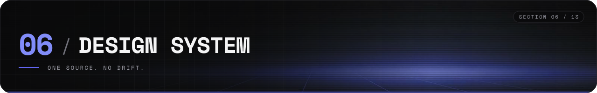
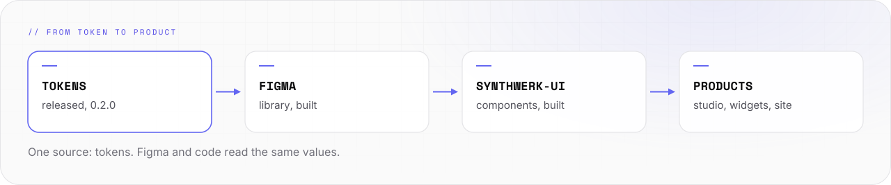
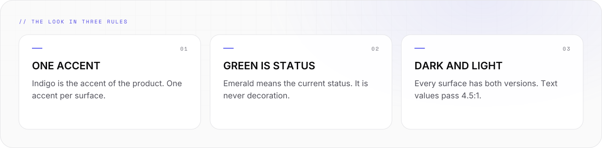

# Design system



One visual language for every Synthwerk surface: READMEs, websites, the studio, the widgets.

- **Today:** design tokens are released as `@synthwerk/tokens` 0.2.0. The [Figma library](https://www.figma.com/design/e7RJDqZc1F6TBW0Bqad8KG) holds the tokens as variables and is built from code. The presence style guide covers READMEs and banners.
- **Next:** the `synthwerk-ui` component package.

```text
-- 01 -------------------------------------------------- DESIGN SYSTEM --

  +-----------+     +-----------+     +--------------+     +----------+
  |  tokens   | --> |   Figma   | --> | synthwerk-ui | --> | products |
  | released  |     |   built   |     |   planned    |     | planned  |
  +-----------+     +-----------+     +--------------+     +----------+

  one source: tokens. Figma and code read the same values.
```

<picture>
  <source media="(prefers-color-scheme: dark)" srcset="../assets/docs/design-flow-v2-dark.svg">
  
</picture>

<picture>
  <source media="(prefers-color-scheme: dark)" srcset="../assets/docs/design-rules-v2-dark.svg">
  
</picture>

## The layers

| Layer | What it is | Where | State |
|---|---|---|---|
| Tokens | Colours, themes, type, radii as CSS variables, Tailwind theme and JSON | [synthwerk-sdk / packages/tokens](https://github.com/VelimirMueller/synthwerk-sdk/tree/main/packages/tokens) | released, 0.2.0 |
| Presence | README layout, banners, ASCII kit | [presence-style.md](presence-style.md) | written |
| Figma library | Tokens as variables, text and effect styles, 32 component sets, patterns, brand, roadmap | [Figma file](https://www.figma.com/design/e7RJDqZc1F6TBW0Bqad8KG), built from [`.figma/`](../.figma/) | built from code, tokens 0.2.0 |
| `synthwerk-ui` | The Figma components in code | `synthwerk-sdk`, package name not final | planned |
| Product UI | Studio, widgets, public site | `synthwerk-studio`, `synthwerk-widgets` | planned |

## The look

- Near-black page, 1 px borders, no shadows in dark mode.
- A faint grid and one soft glow at the edge. A glow never sits behind text.
- **Inter** for headings and body. **Space Mono** for labels, code and ASCII art.
- White pills for actions. Capital labels with wide tracking.
- Every surface has a dark and a light version.

## Colour

| Role | Dark | Light | Rule |
|---|---|---|---|
| Page | `#0c0c10` | `#fafafa` | Background |
| Surface | `#131318` | `#ffffff` | Cards |
| Text | `#e4e4e7` | `#18181b` | Headlines and body |
| Accent, fill | `#6366f1` | `#6366f1` | Lines, glows, shapes |
| Accent, text | `#818cf8` | `#4f46e5` | Links and labels. 6.5:1 and 6.0:1 on the page |
| Status | `#10b981` | `#047857` as text | One use per view: the current status |

- Values are the `default` theme of `@synthwerk/tokens` 0.2.0. The tokens win when this table and the package differ.

- Indigo is the accent of the product. Use one accent per surface.
- Emerald means status. Do not use it as decoration or as an accent.
- A neon colour fails as text on white. Use the text value of each colour.

## Theme switch

- Set `data-theme` and `data-mode` on `<html>`. Modes are `light`, `dark` and `system`.
- Set `data-group` to change the accent family. The default is the product accent.
- The choice is stored in `localStorage` under `sw:prefs:v1`. Nothing is stored before the user chooses.

## Figma

The Figma library is built. Link: [Synthwerk design system](https://www.figma.com/design/e7RJDqZc1F6TBW0Bqad8KG).

- **Source:** the vfb pack in [`.figma/`](../.figma/). Code builds every board. Do not edit a board by hand: the next build replaces it.
- **Tokens:** `.figma/tokens.json` holds 193 variables, 19 text styles and 3 effect styles. `.figma/tools/tokens.mjs` writes it from `@synthwerk/tokens`.
- **Variables:** collections `primitives`, `theme`, `group`, `size`, `type` and `motion`. Each variable has its scopes, a description and the CSS name as web code syntax.
- **Modes:** the Starter plan has one variable mode. Dark and light are two names: `dark/<role>` and `light/<role>`, aliased to the primitives.
- **Components:** 32 component sets. Each set has `Mode=Dark|Light` and its kinds, states and sizes. Components use variables and text styles only.
- **Check:** `vfb test synthwerk --strict` builds every board against a mock of Figma. Every colour must be a variable and every text must use a text style.

### Pages and sections

The Starter plan allows 3 pages. Foundations, Components and Patterns are sections on the page **Design**. Brand and Roadmap share page 3.

| Page | Section | Content |
|---|---|---|
| Design | `00 · Cover` | Wordmark, what Synthwerk is, the file map |
| Design | `01 · Foundations` | Colour roles for dark and light with contrast, primitives, group and service accents, type, space, radius, effects, grid, the `Icon` set |
| Design | `02 · Components` | Button, Icon button, Link, Input, Textarea, Select, Checkbox, Radio, Switch, Form field |
| Design | `02 · Components · Content` | Status pill, Badge, Avatar, Card, Divider, ASCII rule, Terminal snippet, Code block |
| Design | `02 · Components · Navigation` | Tabs, Breadcrumbs, Pagination, Table row, Table, Nav bar, Footer |
| Design | `02 · Components · Feedback` | Tooltip, Toast, Progress, Skeleton, Empty state, Modal |
| Design | `03 · Patterns` | Hero, stats row, feature cards, flow diagram, status table, plan block, README banner. All from instances |
| Tech | `10 · Platform` | The eight repos with art, stack and status |
| Tech | `11 · Architecture` | Lanes diagram and the ASCII ecosystem map |
| Tech | `12 · Demo stack & tokens` | Demo stack, token pipeline, variable counts, token mapping |
| Brand & Roadmap | `20 · Brand` | Wordmark `SYNTHWERK.`, banners, social preview, art strips, brand palette, rules |
| Brand & Roadmap | `21 · Roadmap` | The milestones of [roadmap.md](roadmap.md) as a board, epics, sprints, design track |

### Rebuild the library

1. Change the token in `synthwerk-sdk/packages/tokens/src/tokens.ts` and release the package.
2. Run `node .figma/tools/tokens.mjs` to write `.figma/tokens.json`.
3. Run `vfb test synthwerk --strict`. All sections must pass.
4. Run `vfb build`, then `vfb up`.
5. In Figma desktop, open the file and start Plugins → Development → VM Design Builder.
6. Click **Sync tokens**, then **Build**.
7. Read `.figma/out/report.json` and the screenshots in `.figma/out/shots/`.

- Figma variables mirror the token names. A change starts in the tokens, not in Figma.
- Section names are identities. Do not rename a section.
- A component enters `synthwerk-ui` after it exists in Figma with all states and both modes.

## `synthwerk-ui`

- Purpose: every Synthwerk product uses the same components, so the look cannot drift.
- First set: the components of the Figma **Components** page.
- Each component reads tokens only. No colour or size is written into a component.
- Checks: contrast of 4.5:1 or more for text, visible focus, keyboard use, both modes.

## Rules

- Do not copy a colour value into a product. Import the token.
- Do not add a colour for one screen. Change the token set, with a reason.
- A new look gets a new file version (`-v3`). GitHub caches images by address.
