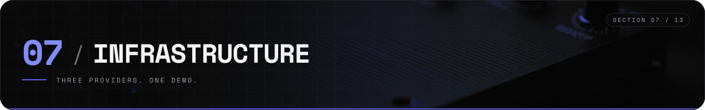
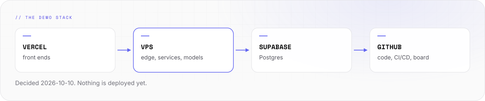

# Infrastructure



Where Synthwerk runs. This page covers hosting, the database and the demo.

- **Today (2026-10-23):** vision runs on dev on the VPS, deployed by digest on every merge to `main`. A second, small VPS watches it from outside. The other services run on a developer machine.
- **Decided 2026-10-10:** the demo runs on the stack below.
- **Decided 2026-10-21:** the server is one IONOS VPS. It replaces the earlier plan of one VM per environment.
- **Open:** the database and front ends for prd, and whether dev, stg and prd share the VPS. See [Open decisions](#open-decisions).

<picture>
  <source media="(prefers-color-scheme: dark)" srcset="../assets/docs/infra-flow-v2-dark.svg">
  
</picture>

## Demo stack

```text
-- 01 ----------------------------------------------------- DEMO STACK --

   visitor
      |
 +----v-----------+        +-------------------+
 |  Vercel        |  API   |  VPS              |
 |  front ends    +------->+  edge, services,  |
 |  studio, site  |        |  local models     |
 +----+-----------+        +---------+---------+
      |                              |
      |        +----------------+    |
      +------->+  Supabase      +<---+
               |  Postgres      |
               +----------------+

   GitHub: code, CI/CD, ticket board      Figma: design, roadmap
```

| Part | Runs on | Purpose |
|---|---|---|
| Front ends | Vercel | Studio, public site, demo pages |
| Back end | One IONOS VPS | Edge, services, event bus, heavy computing, local models |
| Database | Supabase | Postgres for the demo |
| Code and tasks | GitHub | Repos, Actions, ticket board, releases |
| Design | Figma | Design system, roadmap board |

- The demo shows a distributed system: a front end, a back end and a database on three providers.
- The VPS runs the models for the Synthwerk tools, as far as its hardware allows.
- The VPS size is in [The VPS](#the-vps).

## The VPS

Measured on 2026-10-22 and 2026-10-23 with `lscpu`, `free -h`, `df -h`, `lsblk` and a direct write test (#7). The plan said 8 cores; the VPS has 4.

| Part | Value |
|---|---|
| Provider | IONOS VPS, EU region |
| CPU | 4 vCPU, AMD EPYC-Milan (KVM), AVX2, no AVX-512 |
| Memory | 7.7 GiB, plus a 4 GiB swap file |
| Disk | 237 GB, about 525 MB/s direct write (SSD class; the virtual disk reports `ROTA 1`, which says nothing on a VM) |
| GPU | None |
| OS | Debian 13 "trixie", kernel 6.12 |
| Network | About 1.2 Gbit/s download |
| Hardening | Key-only SSH, fail2ban, unattended upgrades, IONOS firewall policy; Lynis index 79 |

### The watcher VPS

| Part | Value |
|---|---|
| Role | Outside watcher: Gatus behind Caddy, public page https://status.velimir-mueller.de, ntfy alerts |
| Size | 1 vCPU, 854 MB usable memory, 20 GB disk, 2 GB swap |
| Checks | dev host from outside, heartbeats from inside (`host`, `vision`), the public sites |
| Config | `synthwerk-infra/watch/` |

- It is too small for telemetry or models. Telemetry stays on the dev VPS.

### Memory budget (estimate)

| Part | Memory |
|---|---|
| OS and Docker | about 0.5 GB |
| Edge, NATS, Zitadel, Go services | about 1.5 GB |
| Telemetry stack | about 1 GB |
| Vision service | 0.7 GB measured (limit 3 GB) |
| Left for the chat model | about 3 to 4 GB |

- **Largest chat model: 3B to 4B parameters at 4-bit (Q4), on the CPU.** A 7B model does not fit next to the rest of the stack.
- 4 vCPU make answers stream slower than the 8 cores the plan assumed. The eval in #72 measures the speed.
- Swap catches peaks only. A model that needs swap to fit is too big.

## Hosting and database

| Topic | Demo | Notes |
|---|---|---|
| Front-end hosting | Vercel | Preview build per pull request |
| Back-end hosting | IONOS VPS | Docker Compose. One host |
| Database | Supabase Postgres | One project for the demo |
| Event bus | NATS on the VPS | Runs locally in `synthwerk-infra`. Not on the VPS yet |
| Edge | Traefik and a web application firewall on the VPS | Runs locally in `synthwerk-infra`. Not on the VPS yet |
| Telemetry | OpenTelemetry stack on the VPS | Runs locally in `synthwerk-infra`. Not on the VPS yet |
| Models | Local models on the VPS | CPU only. About 3B to 4B at 4-bit, see [The VPS](#the-vps) |
| Secrets | GitHub environment secrets | No secret in a repo |

## Environments

| Name | Trigger | Data |
|---|---|---|
| dev | Merge to `main` | Synthetic. Reset is allowed |
| stg | Tag `vX.Y.Z` | Synthetic. Same config as prd |
| prd | Manual approval, same image digest as stg | Real |

- One image is built once and promoted by digest. There are no environment branches.
- The demo starts as one environment on one VPS. It is the dev host of milestone M2.
- The full flow is in [ci-cd.md](ci-cd.md).

## Open decisions

| Topic | Earlier plan | Demo stack | To decide |
|---|---|---|---|
| Server provider | Another EU cloud, built with OpenTofu, one VM per environment | One IONOS VPS | Decided 2026-10-21: one IONOS VPS |
| Environments on the VPS | One VM each | dev only | Whether stg and prd share the 7.7 GiB VPS. Today all three deploy to one compose dir, so stg or prd on this host would replace dev |
| Database | Postgres on the server, with its own backups | Supabase | Which one is used for prd |
| Front ends | Served from the server behind the edge | Vercel | Which one is used for prd |
| Mascot host | Its own VM with no network egress | Not placed | Whether the VPS can isolate it |

- A decision here changes [architecture.md](architecture.md). Update both in one pull request.

## Rules

- All data stays in the EU.
- No personal data in the demo. Demo data is synthetic.
- An AI call needs a signed-in user. The demo uses a demo org with a strict rate limit.
