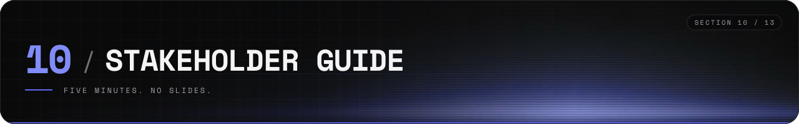
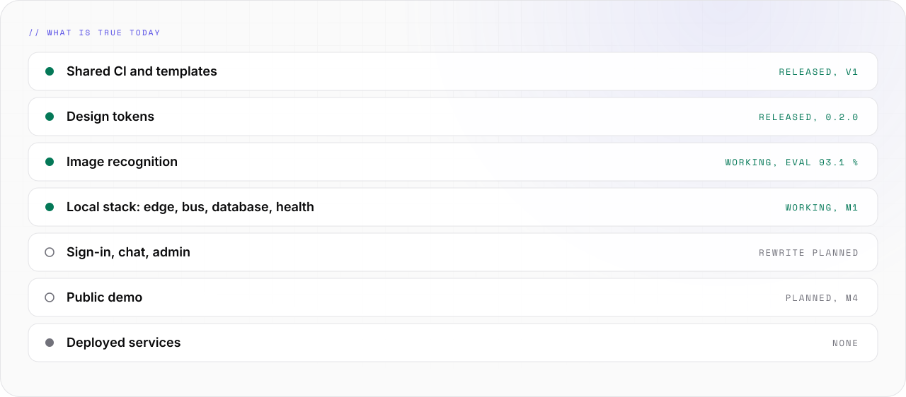

# Stakeholder guide

Synthwerk in five minutes, for people who decide and do not build.

<picture>
  <source media="(prefers-color-scheme: dark)" srcset="../assets/docs/stakeholder-status-v2-dark.svg">
  
</picture>

## What it is

- Synthwerk is a set of small services for AI chat, image recognition and page building.
- You run all of it yourself. Your data stays on your servers.
- One developer can add AI chat to a website in minutes and grow it into a full product.

## What is true today

| Area | State | Proof |
|---|---|---|
| Shared CI and templates | Released, v1.1.0 | [synthwerk-blueprint](https://github.com/VelimirMueller/synthwerk-blueprint) |
| Design tokens | Released, 0.2.0 | [synthwerk-sdk](https://github.com/VelimirMueller/synthwerk-sdk) |
| Image recognition | Working. The eval set scores 93.1 % | [synthwerk-vision](https://github.com/VelimirMueller/synthwerk-vision) |
| Local stack: edge, bus, database, telemetry, pulse | Working locally, milestone M1 | [synthwerk-infra](https://github.com/VelimirMueller/synthwerk-infra) |
| Sign-in, chat, admin | Planned, rewrite | [roadmap.md](roadmap.md) |
| Public demo | Planned, milestone M4 | [infrastructure.md](infrastructure.md) |

- No service is deployed to a host yet. The local stack starts with one command.

## Why it is different

- **Self-hosted.** No closed service holds the data.
- **Modular.** Each part is a separate repo. Use one part or all parts.
- **Local-first.** Development needs no paid AI provider.
- **Safe by design.** No anonymous AI. Access is decided by the user's token, not by a prompt.
- **German and EU law first.** Legal pages, consent and data location are part of the plan.

## When things arrive

| Milestone | Date (estimate) | You can see |
|---|---|---|
| M1 | 2026-11-20 | The stack starts on one machine. A live health view is green |
| M2 | 2027-01-29 | A signed-in user chats with an AI on a test page |
| M3 | 2027-02-26 | The first version runs in production |
| M4 | 2027-04-09 | A public site with a live demo |
| M5 | 2027-05-07 | Paid plans and app templates |
| M6 | 2027-06-04 | Cluster-ready. Card scan works |

- Dates are estimates. The plan has one buffer of two weeks at the end of the year.

## How to follow the work

| Question | Where |
|---|---|
| What is in progress | [Open tasks](https://github.com/VelimirMueller/synthwerk/issues) |
| What changed | [release-notes.md](release-notes.md) |
| What is planned | [roadmap.md](roadmap.md) |
| What it will do | [feature-catalogue.md](feature-catalogue.md) |
| Who it is for | [use-cases.md](use-cases.md) |
| How it looks | [design-system.md](design-system.md) |

## Risks

| Risk | Answer |
|---|---|
| One person builds it | Small repos, shared CI, each part works alone |
| The scope is large | The MVP is epics E0 to E4. All other parts come later |
| Hosting is not final | The demo stack is decided. prd runs on the IONOS VPS (decided 2026-10-29). The prd database and front ends are open, see [infrastructure.md](infrastructure.md) |
| Dates slip | Each milestone has a testable proof. The board shows the state |

## Terms

- Open source under the [MIT license](../LICENSE).
- The operator of the public site is a private person, not a company.
